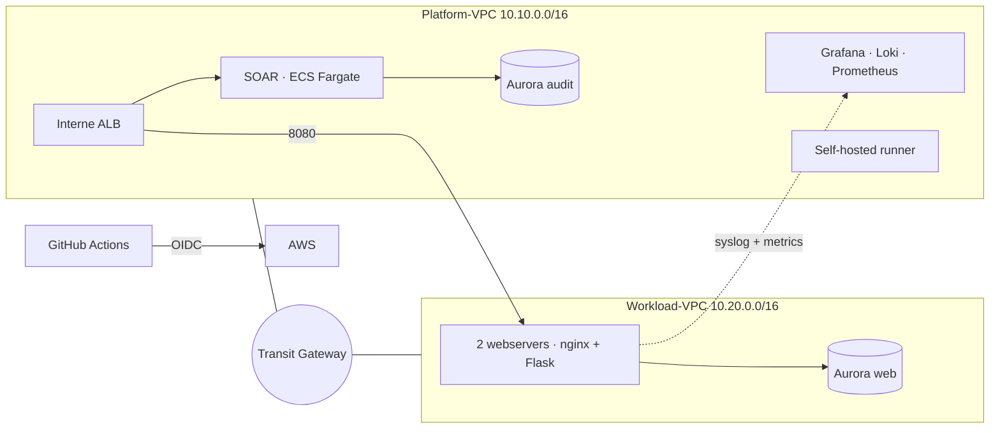

# CS2 — Infrastructure as Code op AWS

Volledig in de cloud, zonder on-premises componenten. Deze repository bouwt
twee VPC's met een Transit Gateway, twee webservers met een eigen database,
een observability-stack, een SOAR en de CI/CD eromheen. Regio:
`eu-central-1`.

De implementatie volgt het ontwerp in
`Design Document CS2 - volledig in de cloud.docx`.

## Architectuur



- **Websites** — twee Linux-servers achter een interne ALB, met een
  gastenboek in een eigen Aurora-database.
- **SOAR** — FastAPI op ECS Fargate, gevoed door EventBridge en SQS; blokkeert
  IP's via een gesimuleerde firewall-API en schrijft audit naar Aurora en S3.
- **Observability** — Grafana, Loki en Prometheus op een private host;
  Grafana Alloy op de servers; CloudWatch voor AWS-logs en flow logs.
- **Toegang** — geen publieke poorten; alles via SSM en de scripts in
  `scripts/`.

## Snel starten

Eenmalig lokaal (state-bucket, GitHub-rol en de omgeving):

```bash
./scripts/bootstrap_state.sh
```

Daarna gaat alles via GitHub:

| Actie | Hoe |
|---|---|
| Uitrollen | Push naar `main` → **Deploy**: tests, `terraform apply`, image bouwen met Docker, ECS uitrollen |
| Handmatig uitrollen | Actions → **Deploy** → Run workflow |
| Uitzetten | Actions → **Destroy** → Run workflow → typ `DESTROY` |

De state staat in S3 met een native lockfile. De GitHub-rol en de state-bucket
staan in `bootstrap/` en overleven een destroy, zodat je daarna direct weer
kunt uitrollen.

> Na een reset van je AWS-lab (alles weg) doe je eenmalig opnieuw
> `./scripts/bootstrap_state.sh`. Daarna werkt de GitHub-flow weer.

## Lokaal werken

```bash
terraform -chdir=infra plan          # wijzigingen bekijken
terraform -chdir=infra apply         # lokaal uitrollen
./scripts/build_push.sh              # alternatief: lokaal met Docker
./scripts/port-forward.sh grafana    # http://localhost:3000
./scripts/port-forward.sh web        # http://localhost:8081
./scripts/port-forward.sh soar       # http://localhost:8080
```

Wachtwoorden en demo-commando's:

```bash
./scripts/grafana_password.sh
./scripts/demo_attack.sh brute       # SOAR end-to-end testen
./scripts/show_audit.sh              # audit in S3
./scripts/db_query.sh                # SQL op de websitedatabase
./scripts/logs_overview.sh           # alle loglocaties
```

## Repository-indeling

| Pad | Inhoud |
|---|---|
| `infra/` | Terraform: netwerk, beveiliging, IAM, databases, SOAR, observability, CI-hulp |
| `infra/backend.tf` | Gedeelde S3-state met lockfile |
| `infra/templates/` | User-data voor de drie EC2-rollen |
| `bootstrap/` | Eenmalig: GitHub OIDC-rol en provider (overleeft destroy) |
| `webapp/` | Flask-gastenboek op de webservers |
| `soar/` | FastAPI-app, regelmotor, acties, audit en tests |
| `lambda/` | Gesimuleerde firewall-API |
| `grafana/` | Datasources en twee dashboards |
| `ansible/` | Inventory, playbook en rollen voor updates |
| `scripts/` | Demo-, deploy-, database- en hulpscripts |
| `docs/` | Demo, logging, kosten, bewijsregister (`BEWIJS.md`) en ontwerpverantwoording |
| `archive/cs1/` | Vorige opdracht (hub-and-spoke), niet actief |

## Wat je kunt demonstreren

| Onderdeel | Bewijs |
|---|---|
| Netwerk | Twee VPC's, Transit Gateway, private subnetten, Security Groups |
| Websites met database | Gastenboek achter de ALB; berichten persistent in Aurora, geschreven door beide servers |
| Observability | Grafana-dashboards, Loki-query's, VPC Flow Logs |
| SOAR | `demo_attack.sh brute` → IP-blokkade, SNS-melding, audit in S3 en Aurora |
| Audit | `/audit/recent`, S3-objecten, `db_query.sh audit` |
| CI/CD | Push → Deploy met OIDC, Docker-build en ECS-uitrol |
| Updates | Ansible-run; tweede run geeft `changed=0` |
| Kosten | Kostenoverzicht en Cost Explorer |

De volledige route staat in **[docs/DEMO.md](docs/DEMO.md)**.

## Documentatie

| Document | Waarover |
|---|---|
| [docs/DEMO.md](docs/DEMO.md) | Demo in 12 minuten, per stap het bewijs |
| [docs/LOGGING.md](docs/LOGGING.md) | Databases, logs, retenties en query's |
| [docs/KOSTEN.md](docs/KOSTEN.md) | Kosten per dag/maand en bespaartips |
| [docs/ONTWERP-VS-CODE.md](docs/ONTWERP-VS-CODE.md) | Ontwerp naast code, met afwijkingen |

## Kosten

Reken op **$ 7–9 per demodag** en **$ 270–300 per maand** als je alles laat
staan. De grootste vaste posten zijn de Transit Gateway en de NAT
Gateways. Opruimen met de Destroy-workflow of `./scripts/destroy.sh`.

## Bewuste afwijkingen

De volledige onderbouwing staat in
[docs/ONTWERP-VS-CODE.md](docs/ONTWERP-VS-CODE.md). In het kort:

- Geen AWS Network Firewall; de blokkade loopt via een gesimuleerde API.
- NACL's staan op default; Security Groups zijn de leidende controle.
- Geen Windows-servers; de demo is Linux (Amazon Linux 2023).
- Object Lock is optioneel, omdat het `destroy` blokkeert.
- Prometheus draait self-hosted; Amazon Managed Prometheus is geblokkeerd
  door een service control policy.
- De webdatabase draait met één instantie (kostenkeuze); de auditdatabase
  heeft twee instanties in twee zones.

## Vereisten

- Terraform ≥ 1.6 (lokaal getest met 1.15)
- AWS CLI v2 + Session Manager-plugin
- `jq` en Python 3 (de scripts gebruiken de AWS CLI)
- Docker is niet nodig op je laptop; Deploy bouwt de image op de GitHub-runner
