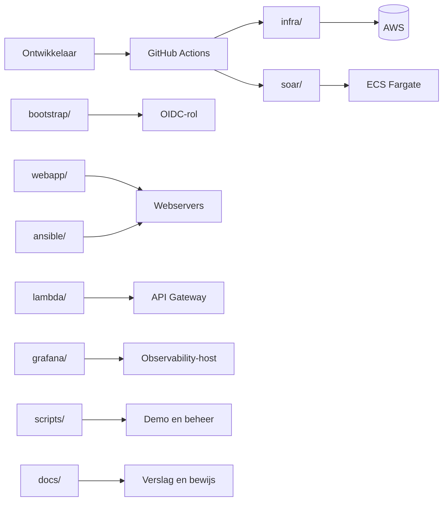

# Repository-overzicht

Rover kan alleen een Terraform-plan lezen. Python, Docker, Ansible, Grafana en documentatie ziet hij niet. Daarom staat hier het overzicht van de hele repository: per map de bestanden en wat ze doen, zodat duidelijk is welk bestand welke rol heeft en hoe de onderdelen samenkomen.

## Samenhang

## Mappen in één oogopslag

| Map | Rol |
|---|---|
| `Repository-root` | Bestanden die voor de hele repository gelden. |
| `.github/workflows/` | De GitHub Actions-pijplijnen. |
| `infra/` | Terraform voor de AWS-omgeving. Dit is de bron van de Rover-graaf. |
| `infra/templates/` | User-data die bij het starten van de EC2-instances draait. |
| `bootstrap/` | Eenmalige stack die een destroy overleeft. |
| `soar/` | De SOAR-applicatie die op ECS Fargate draait. |
| `webapp/` | De website op de bewaakte servers. |
| `lambda/` | De gesimuleerde firewall-API. |
| `grafana/` | Provisioning voor de observability-host. |
| `ansible/` | Configuratie en updates van de servers. |
| `scripts/` | Demo-, deploy- en beheerhulpjes. |
| `docs/` | Documentatie en bewijs. |

## Repository-root

Bestanden die voor de hele repository gelden.

| Bestand | Wat het doet |
|---|---|
| `README.md` | Startpagina: architectuur, snel starten, indeling, demo en kosten. |
| `.gitignore` | Houdt Terraform-state, builds, caches en screenshots buiten Git. |

## .github/workflows/

De GitHub Actions-pijplijnen.

| Bestand | Wat het doet |
|---|---|
| `ci.yml` | Op een pull request: Terraform fmt/validate, pytest en een testimage bouwen. |
| `deploy.yml` | Op push naar main: tests, terraform apply, Docker-image bouwen en ECS uitrollen. |
| `destroy.yml` | Handmatig: de omgeving verwijderen na het typen van DESTROY. |
| `ansible-update.yml` | Wekelijks of handmatig: Ansible-update op de self-hosted runner, met changed=0-check. |
| `diagram.yml` | Maakt het Rover-diagram en commit de SVG/PNG naar docs/diagram/. |

## infra/

Terraform voor de AWS-omgeving. Dit is de bron van de Rover-graaf.

| Bestand | Wat het doet |
|---|---|
| `backend.tf` | S3-backend met native lockfile voor de gedeelde state. |
| `versions.tf` | Terraform- en providerversies; AWS-provider met default-tags. |
| `variables.tf` | Invoerwaarden: project, regio, aantallen, retenties en ACU's. |
| `terraform.tfvars` | De gekozen waarden voor dev (gecommit, bevat geen geheimen). |
| `main.tf` | Locals, Availability Zones en de AL2023 AMI-lookup. |
| `network.tf` | Twee VPC's, subnetten, routes, Transit Gateway, NAT, IGW en de private DNS-zone. |
| `security.tf` | Security Groups per service; deny-by-default. |
| `iam.tf` | IAM-rollen en -policies voor EC2, ECS, Lambda, flow logs en GitHub OIDC. |
| `database.tf` | Aurora-cluster voor de audit, met writer en reader en het DB-geheim. |
| `web_db.tf` | Aurora-cluster voor de website, het web-DB-geheim, SSM-parameters en de app-code in S3. |
| `web.tf` | Interne ALB-listener en target group voor de websites. |
| `workload.tf` | De twee bewaakte webservers in de Workload-VPC. |
| `runner.tf` | De self-hosted GitHub Actions-runner en zijn bootstrap. |
| `soar.tf` | ECS, ALB, SQS/DLQ, EventBridge, Lambda, API Gateway, DynamoDB en SNS. |
| `observability.tf` | Observability-host, S3-buckets, loggroepen, alarmen, DNS-records, flow logs en SSM-parameters. |
| `outputs.tf` | Waarden die de scripts en de demo gebruiken (URL's, bucketnamen, endpoints). |
| `.terraform.lock.hcl` | Provider-lockfile voor reproduceerbare installs. |
| `build/.gitkeep` | Houdt de buildmap voor de Lambda-zip in de repository. |

## infra/templates/

User-data die bij het starten van de EC2-instances draait.

| Bestand | Wat het doet |
|---|---|
| `observability_bootstrap.sh` | Installeert Docker, Grafana, Loki, Prometheus, rsyslog en Alloy. |
| `workload_bootstrap.sh` | Installeert nginx, de Flask-app, Alloy en syslog-forwarding op de webservers. |
| `runner_bootstrap.sh` | Installeert Docker, Ansible en de GitHub Actions-runner. |

## bootstrap/

Eenmalige stack die een destroy overleeft.

| Bestand | Wat het doet |
|---|---|
| `main.tf` | GitHub OIDC-provider en de rol die de workflows aannemen. |
| `variables.tf` | Project, omgeving, regio en de GitHub-repository. |
| `outputs.tf` | Het ARN van de OIDC-rol. |
| `versions.tf` | Terraform- en providerversie plus de S3-backend voor bootstrap. |
| `terraform.tfvars` | De waarden voor de OIDC-rol. |
| `.terraform.lock.hcl` | Provider-lockfile. |

## soar/

De SOAR-applicatie die op ECS Fargate draait.

| Bestand | Wat het doet |
|---|---|
| `Dockerfile` | Bouwt de Python-image voor ECS. |
| `requirements.txt` | Draaiende afhankelijkheden (FastAPI, boto3, psycopg2). |
| `requirements-dev.txt` | Testafhankelijkheden (pytest, httpx). |
| `pytest.ini` | Zet de Python-path en testmap voor pytest. |
| `rules.json` | De zeven regels met prioriteit, voorwaarden en acties. |
| `app/main.py` | FastAPI-endpoints, SQS-worker, dedupe en metrieken. |
| `app/config.py` | Leest de omgevingsvariabelen. |
| `app/models.py` | Het Finding-model en normalisatie van events. |
| `app/rules.py` | Regelmotor: matching en keuze op hoogste prioriteit. |
| `app/actions.py` | Voert block_ip, quarantine en notify uit. |
| `app/audit.py` | Schrijft audit naar S3 en Aurora. |
| `app/__init__.py` | Maakt van app een Python-pakket. |
| `tests/test_rules.py` | Acht tests voor normalisatie, regels en prioriteit. |

## webapp/

De website op de bewaakte servers.

| Bestand | Wat het doet |
|---|---|
| `app.py` | Flask-gastenboek: pagina, POST /bericht, /health en /api/berichten. |

## lambda/

De gesimuleerde firewall-API.

| Bestand | Wat het doet |
|---|---|
| `firewall_api.py` | Lambda die een IP met TTL in DynamoDB blokkeert. |

## grafana/

Provisioning voor de observability-host.

| Bestand | Wat het doet |
|---|---|
| `dashboards/operations.json` | Dashboard voor CPU, geheugen, schijf, netwerk en uptime. |
| `dashboards/soar.json` | Dashboard voor events, acties, fouten en de SQS-wachtrij. |
| `provisioning/dashboards/dashboards.yml` | Laat Grafana de dashboards uit de map laden. |
| `provisioning/datasources/datasources.yml.tftpl` | Datasources: Prometheus, Loki en CloudWatch. |

## ansible/

Configuratie en updates van de servers.

| Bestand | Wat het doet |
|---|---|
| `ansible.cfg` | Inventory, SSH-sleutel, rollenpad en outputinstellingen. |
| `requirements.yml` | De Amazon- en community-collecties. |
| `inventory/aws_ec2.yml` | Dynamische inventory op tags (Project, Environment, Role). |
| `group_vars/all.yml` | Gedeelde waarden: observability-host, poorten en regio. |
| `playbooks/update.yml` | Het updateproces: ping, schijfcheck, rollen, rapport. |
| `roles/common/tasks/main.yml` | Basispakketten en tijdsynchronisatie. |
| `roles/common/tasks/packages.yml` | Installeert chrony, rsyslog, jq en dnf-plugins. |
| `roles/common/tasks/time.yml` | Zet de tijdzone op UTC en start chronyd. |
| `roles/updates/tasks/main.yml` | Werk pakketten bij, herstart indien nodig. |
| `roles/observability_agent/tasks/main.yml` | Controleert de Alloy-agent en de Loki-bereikbaarheid. |

## scripts/

Demo-, deploy- en beheerhulpjes.

| Bestand | Wat het doet |
|---|---|
| `lib.sh` | Gedeelde functies: repo-root, terraform-output en logging. |
| `bootstrap_state.sh` | Eenmalige bootstrap van state-bucket, OIDC-rol en omgeving. |
| `build_push.sh` | Bouwt de SOAR-image met Docker, pusht naar ECR en rolt uit. |
| `db_query.sh` | SQL op de audit- of websitedatabase via de runner. |
| `demo_attack.sh` | Stuurt een demo-gebeurtenis of start CPU-belasting. |
| `destroy.sh` | Lokale destroy met bevestiging. |
| `grafana_password.sh` | Haalt het Grafana-adminwachtwoord uit Secrets Manager. |
| `logs_overview.sh` | Toont loggroepen, buckets en de nieuwste auditobjecten. |
| `port-forward.sh` | SSM-tunnel naar Grafana, de website of de SOAR. |
| `register_runner.sh` | Registreert de self-hosted runner met een GitHub-PAT. |
| `send_event.py` | Stuurt een EventBridge-event via de AWS CLI (geen boto3 nodig). |
| `show_audit.sh` | Toont auditobjecten in S3, de database of live SOAR-logs. |
| `rover_core.py` | Filtert de plan tot de kernresources voor het Rover-diagram. |
| `rover_file_map.py` | Groepeert de plan per bronbestand voor het Rover-diagram. |

## docs/

Documentatie en bewijs.

| Bestand | Wat het doet |
|---|---|
| `DEMO.md` | De demo in 12 minuten, met per stap het bewijs. |
| `LOGGING.md` | Databases, loglocaties, retenties en query's. |
| `KOSTEN.md` | Kosten per dag/maand en bespaartips. |
| `ONTWERP-VS-CODE.md` | Ontwerp naast code, met bewuste afwijkingen. |
| `BEWIJS.md` | Waar je screenshots maakt en wanneer iets geslaagd is. |
| `STRUCTUUR.md` | Dit overzicht: elke map en elk bestand met zijn rol. |
| `diagram/README.md` | Uitleg bij het Rover-diagram. |
| `diagram/terraform-rover.svg` | Het Rover-diagram (vector). |
| `diagram/terraform-rover.png` | Het Rover-diagram als PNG. |

## Archief

`archive/cs1/` bevat de vorige opdracht (hub-and-spoke). Die bestanden doen niet mee in de huidige omgeving en worden niet door de pipelines gebruikt.