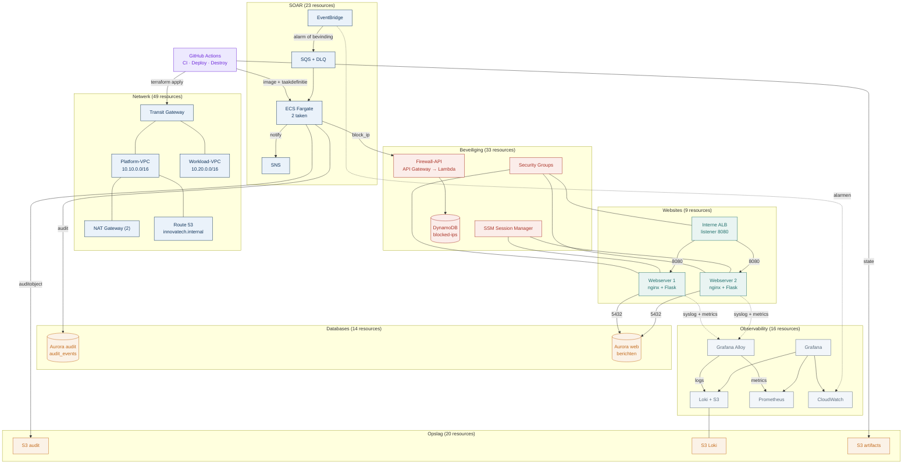

# Terraform-overzicht

Dit diagram wordt gegenereerd uit `infra/*.tf` door `scripts/terraform_overview.py`.
Het toont de lagen en de belangrijkste stromen. Voor de volledige afhankelijkheden
per resource: zie `terraform-rover.svg`.

## Resources per laag

| Laag | Aantal resources |
|---|---|
| Netwerk | 49 |
| Beveiliging | 33 |
| Websites | 9 |
| Databases | 14 |
| Opslag | 20 |
| Observability | 16 |
| SOAR | 23 |
| DevOps | 1 |
